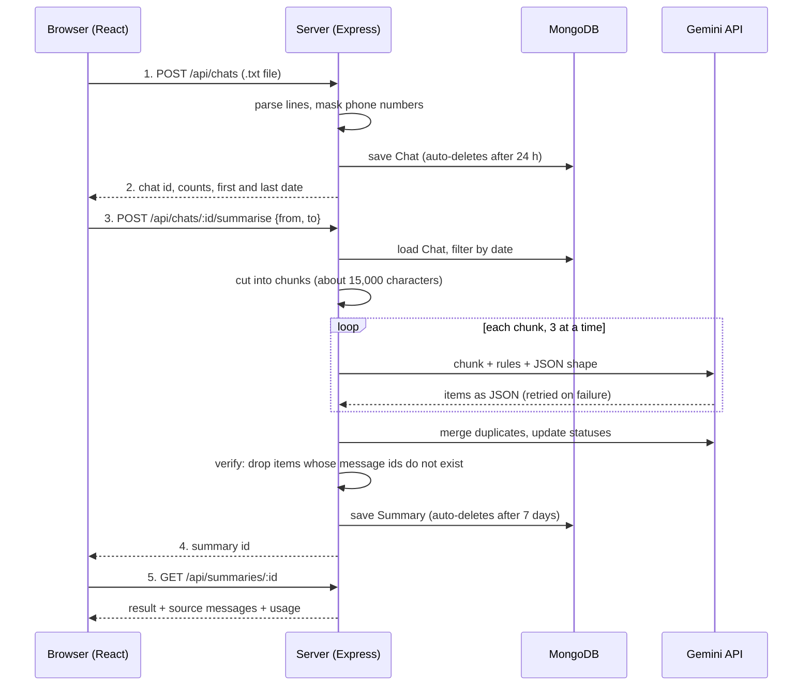

# Society Summariser

**Turn a 3,000-message society WhatsApp group into a one-page brief.**
Upload an exported chat, pick a date range, and get the decisions, pending payments, complaints, upcoming events and unanswered questions. Every item links back to the exact original message, so nothing is taken on trust.

- **Live demo:** `N/A`
- **2-minute video:** `https://drive.google.com/file/d/1oJA1r3VaW5CA6I8J0EG2KJeO7DT2ngWE/view?usp=sharing`

---

## The problem and who has it

Housing-society WhatsApp groups are where decisions, dues and complaints happen, and also where they get lost. The committee secretary or treasurer has to scroll through thousands of messages to answer simple questions:

- What was actually decided?
- Who still has not paid maintenance?
- Which complaints are still open?
- What events are coming up?
- Which questions did nobody answer?

**Primary user:** the committee secretary / treasurer of a housing society or resident welfare association.

## What it does

1. **Upload** a WhatsApp "Export chat" `.txt` file (drag and drop or browse).
2. **Choose a period** with quick presets (last 7 days, last 30 days, entire chat) or custom dates.
3. **Read one page** with six sections: Decisions made, Discussed but not decided, Pending payments, Complaints, Upcoming events, Questions nobody answered.
4. **Check any fact** with the Source buttons, which open the original message.
5. **Work with it:** search, filter by section, sort (latest, oldest, highest amount, most discussed), copy as WhatsApp-ready text, or print / save as PDF.
6. **Come back later** from the "Past summaries" list (links are stored in your browser only).

## Architecture



**Design ideas**

1. **Privacy first.** Phone numbers are masked on the server before anything is saved or sent to the AI. Uploaded files are held in memory, never written to disk.
2. **Never trust the AI blindly.** Every item must cite message ids. A verification step deletes any item whose ids do not exist.
3. **Be kind to limits.** Long chats are chunked; AI calls are retried with back-off; one failed chunk produces a warning instead of a crash; endpoints are rate-limited; old data deletes itself.

## Tech stack

| Layer | Tools |
|---|---|
| Frontend | React, Vite, React Router, Axios |
| Backend | Node.js, Express, Multer (uploads), express-rate-limit |
| Database | MongoDB with Mongoose (TTL indexes for auto-deletion) |
| AI | Google Gemini via `@google/genai` (JSON output, low temperature) |

## Project structure

```
backend/
  server.js              starts Express, mounts routes
  config/db.js           connects to MongoDB
  models/
    chat.js              uploaded chat (auto-deleted after 24 h)
    summary.js           finished summary (auto-deleted after 7 days)
  routes/
    chats.js             POST /api/chats, POST /api/chats/:id/summarise
    summaries.js         GET /api/summaries/:id
  services/
    parser.js            WhatsApp .txt -> message objects
    privacy.js           phone-number masking
    chunker.js           splits messages into chunks
    llm.js               Gemini calls with retry and usage counting
    summarise.js         chunk -> ask -> merge -> verify -> sources -> cost

frontend/src/
  api.js                 Axios instance
  pages/Home.jsx         upload, date range, past summaries
  pages/SummaryPage.jsx  loads and shows one summary
  components/
    NavBar.jsx
    SummaryView.jsx      tabs, search, sort, sources, copy, print
    summaryConfig.js     sections, sorting, searching, WhatsApp text
```

Adjust folder names above if your repo differs.

## How to run it

**You need:** Node.js 18 or newer, a MongoDB database (a free Atlas cluster works), and a Gemini API key.

### 1. Backend

```bash
cd backend
npm install
```

Create `backend/.env`:

```env
MONGO_URI=your-mongodb-connection-string
GEMINI_API_KEY=your-gemini-api-key
CHAT_MODEL=the-gemini-model-name-you-use
PRICE_IN_PER_M=0      # USD per million input tokens, used for the cost display
PRICE_OUT_PER_M=0     # USD per million output tokens
PORT=5000
```

Then start it (use the script name from your `package.json`):

```bash
npm run dev
```

### 2. Frontend

```bash
cd frontend
npm install
```

Optional `frontend/.env` (defaults to `http://localhost:5000/api`):

```env
VITE_API_URL=http://localhost:5000/api
```

```bash
npm run dev
```

Open the address Vite prints (usually `http://localhost:5173`).

### 3. Try it

Export a WhatsApp group chat (**Export chat, Without media**) and drop the `.txt` file on the home page. For a safe demo, use a sample chat with invented names and numbers.

## API

| Method and path | Body | Success | Errors |
|---|---|---|---|
| `POST /api/chats` | multipart form, field `file` (`.txt`, max 10 MB, 5 to 30,000 messages) | `201` `{ id, messageCount, participants, firstDate, lastDate }` | `400` bad or empty file, `500` |
| `POST /api/chats/:id/summarise` | `{ from, to }` as `YYYY-MM-DD` | `201` `{ id }` | `400` bad dates, id or too few messages, `404` upload expired, `429` rate limit (15 per hour per IP), `500` |
| `GET /api/summaries/:id` | none | `200` `{ id, from, to, messageCount, result, sources, usage }` | `400` bad id, `404` not found or expired |

## Cost per run

The app records token usage for every run and shows it in the footer of each summary:

```
cost (USD) = (input tokens x PRICE_IN_PER_M + output tokens x PRICE_OUT_PER_M) / 1,000,000
```

**Worked example (illustrative prices, not real quotes):** 20,000 input tokens and 2,000 output tokens at 0.10 and 0.40 USD per million tokens = **0.0028 USD** per run.

**Measured on real chats** (replace with your own numbers from the summary footer):

| Chat | Messages | Chunks | AI calls | Tokens (in + out) | Cost (USD) |
|---|---|---|---|---|---|
| `<small chat>` | | | | | |
| `<medium chat>` | | | | | |
| `<large chat>` | | | | | |

Cost grows with chat length: more messages mean more chunks, plus one extra merge call when there is more than one chunk.

## Privacy

- Phone numbers (and phone-number sender names) are masked to `XXXXXX` plus the last two digits before saving or sending to the AI.
- Uploaded files stay in server memory and are not written to disk.
- Uploaded chats are deleted automatically after **24 hours**; summaries after **7 days**.
- The "Past summaries" list lives in the browser's localStorage, on your device only.
- Masking is best effort (pattern-based). Review it before using the tool on sensitive chats.

## What broke, and how I fixed it

> **Replace this with your own story.** One or two lines in the form: *"X broke because Y; I fixed it by Z."*
>
> Example format: *"The summary showed items the chat never mentioned. I made the AI cite message ids and added a verification step that deletes any item whose ids do not exist."*

## Business sense

- **Who would pay:** housing societies, resident welfare associations and property-management companies that run many groups.
- **Pricing idea (to validate, not proven):** a small monthly fee per society, or a pay-per-summary plan. Because one run costs a fraction of a rupee in AI usage, the margin is large; the real work is trust and ease of use.
- **Why they would pay:** it saves the committee hours of scrolling and makes dues and decisions auditable, because every line points to its source message.

## Known limits

- WhatsApp exports only; the format parser covers common Android and iPhone styles but not every variant.
- If every date in a chat has both numbers 12 or below, day/month order is assumed to be day first.
- AI output can still be incomplete or misread context. The Source buttons exist so a human can check.
- Rate limiting is per IP address, so people on one network share the limit.
- A single MongoDB document is limited to 16 MB, which very large chats with very long messages could approach.

## Roadmap

- Friendlier error messages for rejected uploads
- Automated tests for the parser, masking and sorting helpers
- Stronger phone-number and email masking
- Progress indicator while the AI works
- Accounts, so a committee can keep summaries across devices

## License

`<choose a license, for example MIT>`
