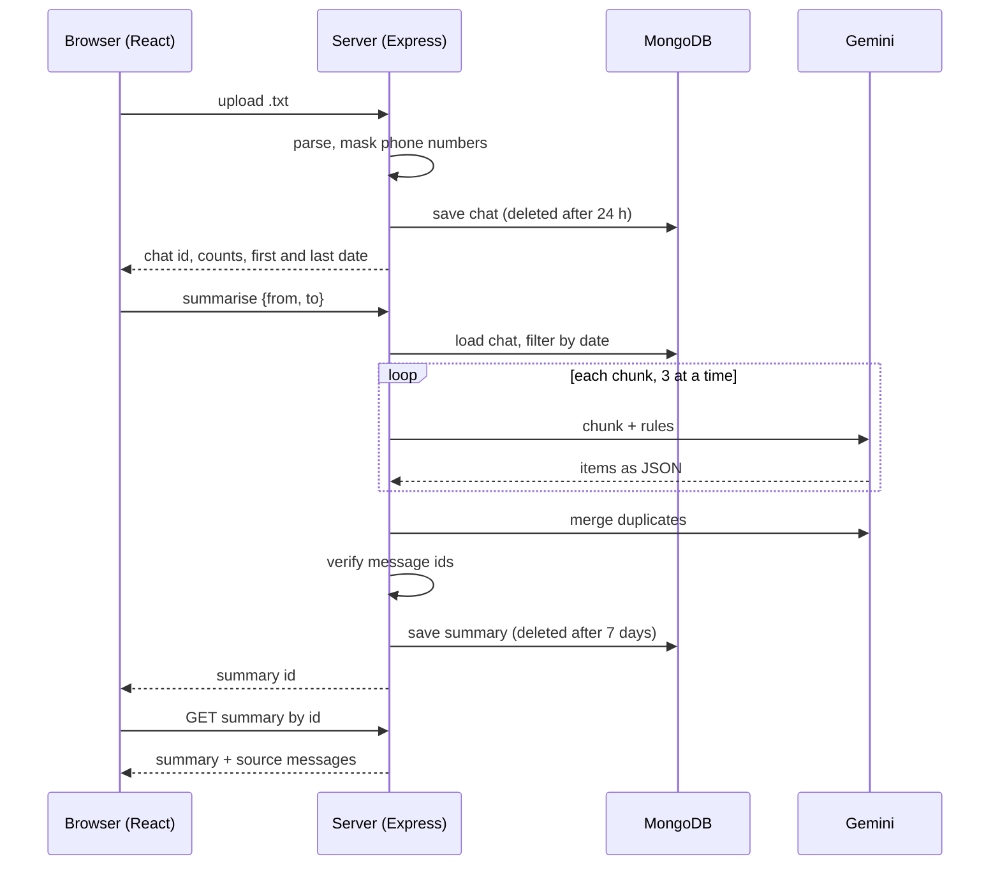

# Society Summariser

I built this for the WhatsApp groups that housing societies run. They end up with thousands of messages, and the committee has to scroll through all of it to find who hasn't paid, what was decided, and which complaints are still open. You upload the exported chat, pick a date range, and get one page with the answers. Each item has a Source button that opens the original message, so you can check it yourself.

**Video:** https://drive.google.com/file/d/1oJA1r3VaW5CA6I8J0EG2KJeO7DT2ngWE/view?usp=sharing
**Live demo:** not deployed. It runs locally, and the video shows a real run.

## What you get

After you upload a chat and pick dates, the summary page has six sections: decisions made, things discussed but not decided, pending payments, complaints, upcoming events, and questions nobody answered. You can search, filter by section, sort (latest, oldest, highest amount, most discussed), copy the result as text for WhatsApp, or print it as a PDF. Past summaries are listed on the home page, but only in your own browser.

## How it works

The browser sends the `.txt` file to an Express server. The server parses the lines into messages, masks phone numbers, and saves the chat in MongoDB. When you ask for a summary, it keeps the messages in your date range, cuts them into chunks of about 15,000 characters, and sends each chunk to Gemini (three at a time). Gemini answers in JSON. The server merges duplicates, checks the answers, and saves the summary. The browser only gets an id back and then loads the summary from it.



Built with React, Vite, React Router and Axios on the front. Node, Express, Multer and express-rate-limit on the back. MongoDB with Mongoose, and Google Gemini through `@google/genai`.

## Project layout

```
backend/
  server.js
  config/db.js
  models/        chat.js, summary.js
  routes/        chats.js, summaries.js
  services/      parser.js, privacy.js, chunker.js, llm.js, summarise.js
frontend/src/
  api.js
  pages/         Home.jsx, SummaryPage.jsx
  components/    NavBar.jsx, SummaryView.jsx, summaryConfig.js
```

## Running it

You need Node 18 or newer, a MongoDB database (a free Atlas cluster is fine) and a Gemini API key.

Backend, in `backend/.env`:

```env
MONGO_URI=...
GEMINI_API_KEY=...
CHAT_MODEL=...
PRICE_IN_PER_M=0
PRICE_OUT_PER_M=0
PORT=5000
```

```bash
cd backend
npm install
npm run dev
```

Frontend (set `VITE_API_URL` only if your backend isn't on `http://localhost:5000/api`):

```bash
cd frontend
npm install
npm run dev
```

Then open the address Vite prints. To try it, export a group chat from WhatsApp (Export chat, Without media) and drop the `.txt` file on the home page. Use a chat with made-up names if you are going to share your screen.

## API

| Request | What it does |
|---|---|
| `POST /api/chats` | Upload the `.txt` file (max 10 MB, 5 to 30,000 messages). Returns the chat id, message count, number of senders and the first and last dates. |
| `POST /api/chats/:id/summarise` | Body is `{ from, to }` as `YYYY-MM-DD`. Limited to 15 per hour per IP. Returns the summary id. |
| `GET /api/summaries/:id` | Returns the summary, the source messages it points to, and the usage numbers. |

## Cost

Bigger chats cost more than smaller ones. A long chat gets cut into more chunks, every chunk is a separate call to Gemini, and when there is more than one chunk there is one extra call at the end to merge the results. Every summary shows its token count in the footer. These are three real runs:

| Period summarised | Parts read | AI calls | Tokens used |
|---|---|---|---|
| 7 days | 1 | 1 | 12,154 |
| 11 days | 1 | 1 | 15,206 |
| 34 days | 2 | 2 | 21,734 |

The footer also shows a dollar cost, worked out from `PRICE_IN_PER_M` and `PRICE_OUT_PER_M` in the `.env` file. I'm on the free Gemini tier and left those at 0, so it shows $0.0000. To see an estimate, put your model's published prices (USD per million tokens) in those two variables.

## Privacy

Phone numbers (including senders that are just a number) are masked to `XXXXXX` plus the last two digits before anything is saved or sent to the AI. The uploaded file stays in memory and is never written to disk. Chats are deleted by MongoDB after 24 hours and summaries after 7 days. The past-summaries list is kept in your browser's localStorage. The masking is pattern-based, so it can miss odd number formats. Check it before using a sensitive chat.

## What broke

The first version trusted whatever the AI said. Sometimes it returned an item that pointed at a message id that wasn't in the chat, which means it had made the fact up. I fixed it in two parts: the prompt now requires every item to list the message ids it came from, and after the AI answers, the server deletes any item whose ids don't exist. This only checks that the message exists, not that it says the same thing, which is why every item also has a Source button.

## Who it could be for

Housing societies, resident welfare associations and property managers who handle many groups. One summary costs very little, so a small monthly fee per society could work. I haven't tested that with real customers.

## Known limits

- It only reads WhatsApp exports. The parser handles the common Android and iPhone formats, not every variant.
- If every date in a chat has both numbers 12 or below, it guesses day before month.
- The AI can still miss things or misread context.
- The rate limit is per IP address, so people on one network share it.
- Anyone with a summary link can open it for 7 days. There are no accounts.

## What I'd do next

Friendlier errors when an upload is rejected, tests for the parser and the masking, better detection for phone numbers and emails, a progress indicator while the AI works, and accounts so a committee can keep summaries across devices.
